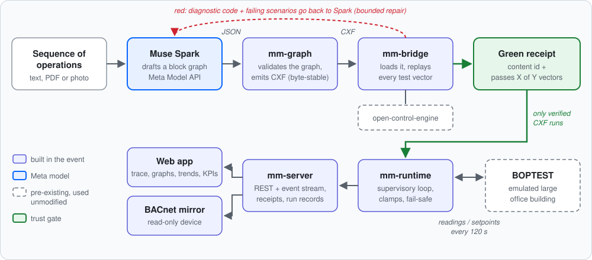
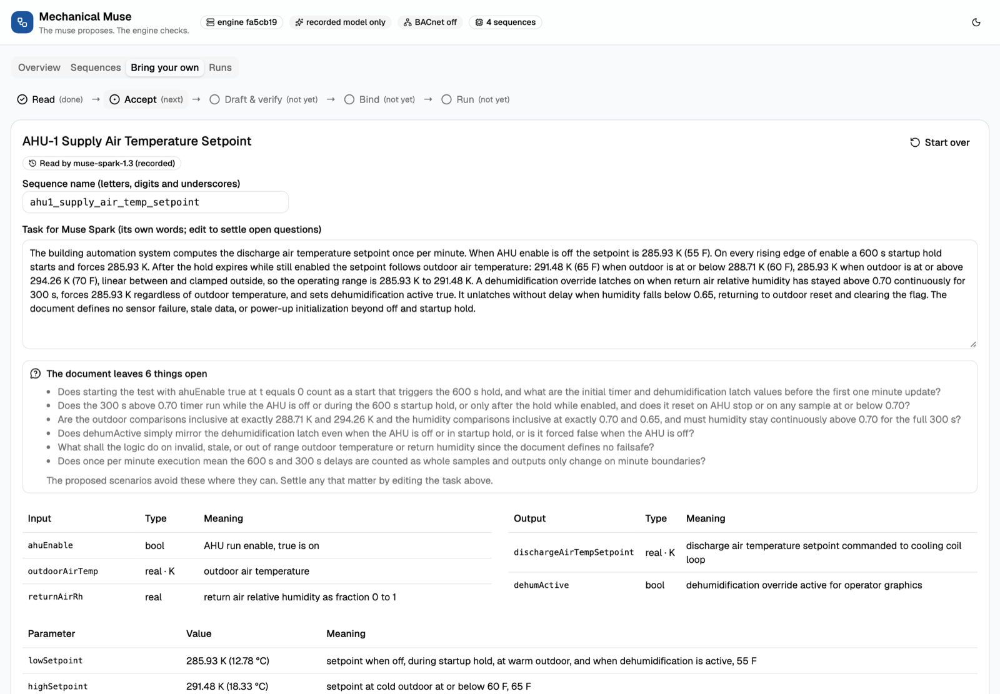
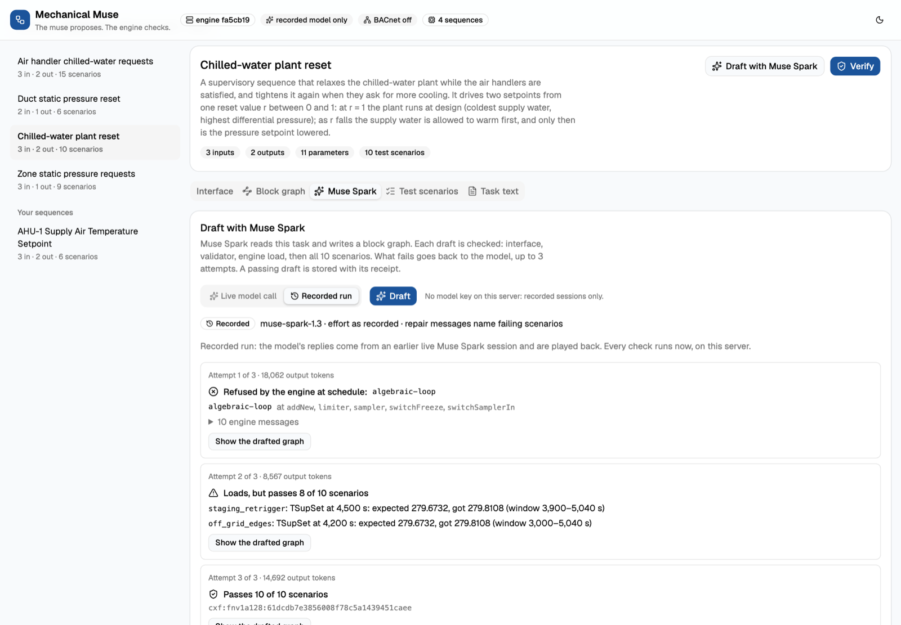
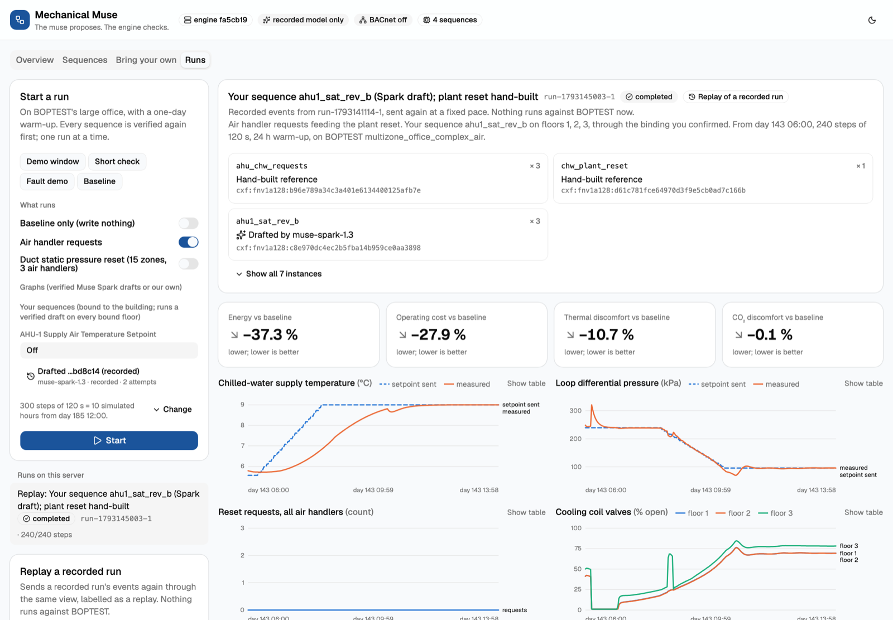
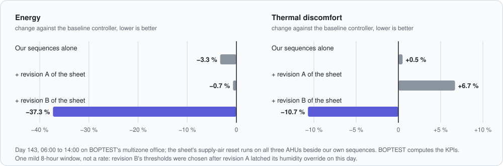

# Mechanical Muse

**The muse proposes. The engine checks.**

Mechanical Muse is an agent built on Meta's Muse Spark. It turns a written sequence of operations into running building control logic, and that logic may run only once it passes its tests. Muse Spark drafts the logic as a block graph. A deterministic control engine replays test vectors against every draft, and failures go back to Spark for repair. Only a draft with a green verification receipt runs on an emulated large office building.

Built solo by Justin Scott for the Meta Global AI Developer Hackathon (Indie track), October 26 to November 4, 2026.

## Why it matters

Building control sequences are written as prose by engineers. A controls contractor then programs them by hand for each building, and they are rarely tested against the written intent before they run. Mistakes show up as wasted energy, discomfort or alarms months later. Language models can draft control logic, but nobody should let unchecked model output drive a building. Mechanical Muse puts a gate in between:

- **Model output is untrusted.** Spark's drafts are data. Nothing it writes reaches the building or the BACnet mirror without a recorded green receipt: a content id plus "passes X of Y" test vectors, replayed on a deterministic engine.
- **Failures are specific.** A refused draft comes back with the engine's typed diagnostic code, or the scenario and instant where an output went wrong. Spark repairs against that, within a fixed budget.
- **Engineers stay in charge.** Bring your own sequence (text, a PDF or a photo of the sheet). Spark proposes test scenarios and lists what the document leaves open, and the engineer accepts or corrects them before they become the gate. Spark proposes how the sequence connects to the building's points; the server checks the proposal and the engineer confirms it.

## What it looks like

**Bring your own sequence.** Muse Spark reads a photo of a sequence sheet into a precise task, lists what the sheet leaves open, and proposes test scenarios for the engineer to accept. The bar at the top follows the sequence from reading to a run.

<picture>
  <source media="(prefers-color-scheme: dark)" srcset="docs/img/screens/workbench-dark.png">
  
</picture>

**Red, then green.** A recorded Muse Spark session on the chilled-water plant reset. The engine refuses attempt 1 (`algebraic-loop`, naming the blocks). Attempt 2 loads but fails 2 of 10 scenarios, each with the instant and the expected value. Attempt 3 passes all 10 and gets a content id.

<picture>
  <source media="(prefers-color-scheme: dark)" srcset="docs/img/screens/authoring-dark.png">
  
</picture>

**On the building.** A replay of revision B on BOPTEST beside our own sequences: each sequence's origin and content id, KPIs against the baseline over the same window, and live trends of what was sent against what the building measured.

<picture>
  <source media="(prefers-color-scheme: dark)" srcset="docs/img/screens/run-dark.png">
  
</picture>

## Results so far

| What | Result | Where |
| --- | --- | --- |
| Muse Spark rebuilding 137 open fault-detection rules from scrubbed tasks, scored by replaying the library's 1,760 test vectors | First try 122 to 125 of 137 rules; after repair 130 to 132 (3 runs, `muse-spark-1.3-contributor`). Constant baselines pass 0 rules | [docs/benchmark-results.md](docs/benchmark-results.md) |
| Chilled-water plant reset, verified, then run on BOPTEST against its baseline controller for 10 hours | Whole-building energy −4.7 %, chiller energy −14.2 %, thermal discomfort +2.0 % | [docs/runtime-results.md](docs/runtime-results.md) |
| A photo of a supply-air reset sheet: read, scenarios accepted, drafted (red, then green), bound to BOPTEST, run; then the engineer revises the sheet and runs it again | Revision A ran but its humidity override latched, so its reset never acted. Revision B: energy −37.3 %, thermal discomfort −10.7 % over one 8-hour window | [docs/workbench.md](docs/workbench.md) |
| Injected sensor fault (NaN supply-air temperature) during a live run | The reading shows as no data, the affected sequences go degraded, their setpoints are handed back to BOPTEST's own controllers, and the reset writes again once the sensor returns | [docs/runtime-results.md](docs/runtime-results.md) |

Every BOPTEST number is a short window, compared with BOPTEST's own baseline controller over the same window, and BOPTEST computes the KPIs. These are results from a simulation, not field measurements. The [results log](docs/results-log.md) lists every run, including the ones that went badly.

## Try it in two minutes

1. `make docker-demo` (only Docker needed), or `make demo` with Rust and Node. Open http://localhost:8080.
2. **Sequences** → *Chilled-water plant reset* → *Muse Spark* → play the recorded session. You can watch a draft fail its vectors and get repaired to a green receipt.
3. **Bring your own** → *Use the sample sequence sheet*. Spark's reading of a photo of a sequence (recorded), its proposed scenarios and the open questions it lists.
4. **Runs** → replay the day 143 morning run with revision B: trends, and KPIs beside the baseline over the same window. The day 186 fault demo shows the fail-safe handing control back.

Without a model key or BOPTEST everything above plays back from recordings, and the UI labels each one "recorded" or "replay". Add a Meta Model API key for live authoring, and a BOPTEST URL for live runs (below).

## Run it

Quickest: `make demo`, then open http://127.0.0.1:8080. It builds the web app and serves it from
the API on one address. With no model key and no BOPTEST it still verifies every spec, plays back
a recorded Muse Spark session, recorded BOPTEST runs and recorded explanations, all labelled as
recorded. `make demo-live` adds live Muse Spark from a key in `.env`; set `MM_BOPTEST_URL` for
live runs and `MM_BACNET_ADDR` for the BACnet mirror.

### Run it without toolchains

With only Docker: `docker compose -f compose.demo.yaml up --build` (or `make docker-demo`), then
open http://localhost:8080. Same recorded mode as `make demo`, no key and no BOPTEST needed; the
first build takes several minutes. Add `-f compose.demo.live.yaml` for live Muse Spark from your
own `MODEL_API_KEY` in `.env`. On Modal: `modal serve deploy/modal/mm_demo.py`. Details, live
mode and troubleshooting: [docs/packaging.md](docs/packaging.md).

### Full setup

You need Rust (see `rust-toolchain.toml`), Node (`web/.nvmrc`) and a BOPTEST v0.9.0 checkout
(`git clone --branch v0.9.0 --depth 1 https://github.com/ibpsa/project1-boptest`).

1. BOPTEST, either locally with Docker (`export BOPTEST_DIR=<checkout>; make boptest-up`, slow on
   Apple silicon) or on Modal with native x86 (`make boptest-modal`, see
   [docs/boptest-on-modal.md](docs/boptest-on-modal.md)).
2. The server: `make server` (set `MM_BOPTEST_URL` for Modal). For live Muse Spark authoring, put
   a Meta Model API key in `.env` as `MODEL_API_KEY` and run `make server-live`.
3. The web app: `cd web && npm ci && npm run dev`, then open the printed address.
4. Optional: mirror live runs read-only over BACnet/IP with `MM_BACNET_ADDR=0.0.0.0:47808` on the
   server ([docs/bacnet-mirror.md](docs/bacnet-mirror.md)).

Without BOPTEST or a model key, the web app can still verify the specs, play back the recorded
Muse Spark session (labelled "recorded"), and replay recorded BOPTEST runs (labelled "replay").

## Built during the hackathon

Everything in this repository was written during the event, starting October 26, 2026, except the pre-existing material listed in the next section (for example the open-control-library rules copied unmodified into `fixtures/open-control-library/` as test data). The commit history is the record.

| Component | Path | Status |
| --- | --- | --- |
| Engine bridge: load receipts, frame stepping, vector replay | `crates/mm-bridge` | Working offline: replays all 1,760 library scenarios on the pinned engine |
| Block-graph schema and CXF emitter | `crates/mm-graph` | Working offline: validator and emitter round-trip all 137 library rules |
| Muse Spark authoring agent: prompt, Responses client, draft-verify-repair loop | `crates/mm-agent` | Working live against Muse Spark (`docs/model-api.md` section 10); reports progress for live views; plays back recorded runs. With vector feedback, Spark drafts a passing chilled-water plant reset in 2 of 3 benchmark runs, and in 3 of 3 live sessions after the repair message learned to name loops (`docs/benchmark-results.md`) |
| Control sequence specs: our own text, independent reference models, test vectors, hand-built graphs | `specs/` | Four specs, each gated by a test that its reference graph passes every vector and that common mistakes fail: chilled-water plant reset and air handler chilled-water requests (running on BOPTEST); duct static pressure reset and zone static pressure requests (validated and wired into the runtime: the `pressure` run option) |
| Library benchmark harness: scrubbed tasks, baselines, run records | `crates/mm-bench` | First results in `docs/benchmark-results.md` |
| BOPTEST runtime host: supervisory loop, BOPTEST client, fail-safe | `crates/mm-runtime` | Runs the verified AHU requests and CHW plant reset against BOPTEST live; 10-hour comparison with the baseline in `docs/runtime-results.md` |
| HTTP API: specs, typed block graphs, verification receipts | `crates/mm-server` | Working: spec, graph and verify endpoints; authoring sessions (Muse Spark, or a labelled recorded run) streamed as server-sent events, with verified drafts stored with their receipts; BOPTEST run sessions that can run a drafted sequence after replaying its vectors again, or inject a labelled test fault; labelled replays of recorded runs; run records; generated TypeScript types |
| MCP server for coding agents: specs, palette, validator, CXF emitter, vector replay as tools | `crates/mm-mcp` | Working offline over stdio, on the official MCP Rust SDK (`rmcp`): Muse Code or any MCP client drafts a block graph and our tools check it (passes X of Y scenarios, with the same repair text our agent gets); no model calls of its own ([docs/mcp.md](docs/mcp.md)) |
| BACnet device mirror | `crates/mm-bacnet` | Working: live runs served read-only as one BACnet/IP device (55 objects: BOPTEST readings, sequence outputs, setpoints sent); remote writes refused; tested over UDP ([docs/bacnet-mirror.md](docs/bacnet-mirror.md)) |
| Web app | `web/` | Working: specs and verification receipts; Muse Spark authoring followed attempt by attempt (engine refusals, failing scenarios, the green receipt; recorded runs labelled); start BOPTEST runs on reference or drafted graphs and follow them live (status, receipts, trends, KPIs beside a baseline run of the same window, event log); block graph view of reference and drafted graphs, with the blocks a problem names outlined; plain-language explanations written by Muse Spark (labelled; recorded copies for use without a key) of a graph, reference or drafted, whose parts outline their blocks, and of a run's events (faults, handbacks) in an operator's words; replays of recorded runs; bring your own sequence: Muse Spark reads pasted text, a PDF or a photo of a sequence of operations, lists what it leaves open and proposes test scenarios, the engineer reviews and accepts them, then Spark drafts against them, a verified draft downloads as CXF, and once Spark's proposed binding to BOPTEST's points is checked and confirmed it runs on the emulated building beside our own sequences ([docs/workbench.md](docs/workbench.md)) |
| Design notes and API references | `docs/` | Started |
| Coding-agent setup: agent context, project skills, verification hook | `AGENTS.md`, `.agents/skills/`, `.muse/`, `.mcp.json`, `scripts/` | Started |

Every model call the application makes goes to Muse Spark through the Meta Model API: drafting, repair, reading a sequence, proposing a point binding, explanations and the benchmark. The repository is set up for Meta's Muse Code and for Claude Code as coding tools (one shared `AGENTS.md`, project skills and a verification hook), and coding agents can use the MCP server above.

## Related work

LLM-drafts, tools-verify loops already exist for industrial control code: LLM4PLC (ICSE-SEIP 2024) uses grammar checks, compilation and model checking; SemaPLC (2026) replays scenarios on a PLC runtime. Wan et al. (2025) generated CDL modules with a language model and checked their behavior by human review. Mechanical Muse applies the loop to building sequences in CDL/CXF. Its gate is a deterministic engine replaying test vectors, it publishes a benchmark scored that way, and verified sequences then run closed-loop on a building emulator. To our knowledge, Mechanical Muse is the first open benchmark that scores LLM-authored CDL by replaying test vectors through a deterministic engine, then runs verified sequences closed-loop on a building emulator.

## Pre-existing dependencies (not built during the hackathon)

These are public, open-source projects used unmodified, each pinned to one commit. All but open-control-engine are pinned to commits from before the event. open-control-engine is developed independently in its own public repository; on October 27 we moved our pin to its `development` branch at `fa5cb19`, which includes engine fixes made during the event (some prompted by gaps we reported, listed in `docs/upstream-gaps.md`). Those engine changes are not part of this entry. On the new pin every verdict in our benchmark records is unchanged (`docs/benchmark-results.md`).

| Dependency | Author | License | Pinned commit | Used for |
| --- | --- | --- | --- | --- |
| [open-control-engine](https://github.com/jscott3201/open-control-engine) | Justin Scott | MIT OR Apache-2.0 | `fa5cb19` (`development`, 2026-10-27) | Executing and verifying CDL control sequences |
| [open-control-library](https://github.com/jscott3201/open-control-library) | Justin Scott | MIT OR Apache-2.0 | `124427b` | Fault rules and test vectors for the benchmark; six rules (card, CXF and vectors) and four point dictionaries copied unmodified into `fixtures/open-control-library/` as test data |
| [rusty-bacnet](https://github.com/jscott3201/rusty-bacnet) | Justin Scott | MIT | `1caf4db` (v0.14.0) | BACnet/IP server, objects, types and transport for the read-only mirror; its client in tests |
| [BOPTEST](https://github.com/ibpsa/project1-boptest) | IBPSA Project 1 | BSD-3-Clause style | `9b1610b` (v0.9.0) | Large office building emulator and KPIs |
| [MinIO](https://github.com/minio/minio) and [mc](https://github.com/minio/mc) | MinIO, Inc. | AGPL-3.0 | `f19c534` and `1e78af4` (the releases BOPTEST v0.9.0 names) | BOPTEST's object store, built from source by `deploy/minio` and `deploy/modal` because those releases are no longer published as images; not redistributed |
| [shadcn/ui](https://github.com/shadcn-ui/ui) components | shadcn | MIT | CLI 4.21.4, style radix-nova | UI primitives copied into `web/src/components/ui` by the shadcn CLI, used unmodified except that they import our own `cn` helper |
| [React Flow](https://github.com/xyflow/xyflow) (`@xyflow/react`) | xyflow | MIT | 12.12.0 | Draws block graphs (pan, zoom, typed port handles); the layered layout is our own (`web/src/features/graph/layout.ts`) |
| [rmcp](https://github.com/modelcontextprotocol/rust-sdk) (official MCP Rust SDK) | Model Context Protocol project | Apache-2.0 | 3.5.1 (crates.io, pinned `=3.5.1`; features `server`, `transport-io`) | The MCP protocol side of `crates/mm-mcp` (JSON-RPC over stdio, version negotiation, handshake, discovery); the tools behind it are our own. Brings in [schemars](https://github.com/GREsau/schemars) 1.2.3 (MIT) and a few other ordinary crates (chrono, uuid, tokio-util), all in `Cargo.lock` |
| Node.js, Rust and Debian official container images | OpenJS Foundation, Rust project, Debian (Docker Official Images) | MIT, MIT OR Apache-2.0, DFSG licenses | `node:26.12.1-trixie-slim`, `rust:1.97.1-slim-trixie`, `debian:trixie-slim`, each pinned by digest in `Dockerfile` | Build and runtime base images for the packaged app (`Dockerfile`, [docs/packaging.md](docs/packaging.md)); unmodified |

Ordinary crates.io libraries (such as serde, reqwest, tokio and thiserror) and npm packages (such as React, Vite, Tailwind CSS and Radix UI) are used unmodified under their own licenses; `Cargo.lock` and `web/package-lock.json` pin every version. The Geist font (`@fontsource-variable/geist`) is under the SIL Open Font License 1.1.

## License

Dual-licensed under either of [MIT](LICENSE-MIT) or [Apache-2.0](LICENSE-APACHE), at your option.
