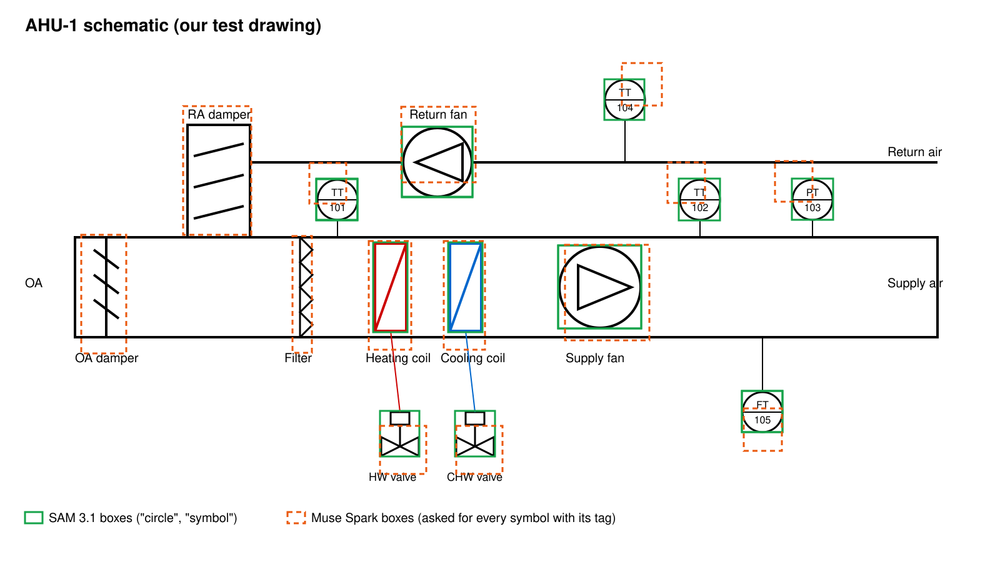

# SAM 3.1 on a control schematic (spike, 2026-10-28)

A time-boxed test of one question: can Meta's SAM 3.1 (`sam-3.1` on the Model API's Responses
endpoint) find equipment and instrument symbols on a building control schematic, and does it add
anything to Muse Spark, which already reads images? Nothing in the product uses SAM yet.

## Setup

- **The drawing:** an air handler schematic we drew for this test (SVG, rendered to a 1600 × 900
  PNG): outdoor and return air dampers, a filter, heating and cooling coils with their valves,
  supply and return fans, and five instrument bubbles (TT-101, TT-102, PT-103, TT-104, FT-105).
  Its true symbol positions come from the SVG itself.
- **SAM 3.1:** one request per concept prompt (a short noun phrase), image as a data URL,
  `include_confidence` on. The reply is a text stream of box and mask tokens in source pixels.
- **Muse Spark** (`muse-spark-1.3`, medium effort, strict JSON schema): asked once for every
  symbol and instrument bubble with its tag and a pixel bounding box.
- **Score:** box overlap with the true position (intersection over union, IoU; 1.0 is exact),
  for the 11 symbols with a well-defined outline (the five bubbles, two fans, two coils, two
  valves).

## Results

| Prompt to SAM 3.1 | Boxes | What they were |
| --- | --- | --- |
| "circle" | 7 | All five instrument bubbles and both fans (confidence about 0.92) |
| "symbol" | 8 | Both fans, both coils, both valves, two bubbles (confidence 0.50 to 0.76) |
| "rectangle" / "triangle" | 5 / 6 | Coils, valve actuators, a damper frame / fan arrows, filter teeth |
| "fan", "damper", "valve", "coil", "temperature sensor", "sensor bubble", "text", "diagram" | 0 | — |

| | Symbols named correctly | Mean IoU (11 symbols) | IoU above 0.5 |
| --- | --- | --- | --- |
| SAM 3.1 ("circle" and "symbol") | none: it returns shapes, not labels | 0.96 | 11 of 11 |
| Muse Spark alone | 14 of 14 (every tag and kind) | 0.43 | 4 of 11 |

Each SAM request took about 0.5 to 3 s; Spark's single answer took 14 s.

## What it means

- **SAM finds shapes, not equipment.** On a line drawing it answers geometric prompts ("circle",
  "symbol") with tight boxes, and domain words ("fan", "valve", "temperature sensor") with
  nothing. It found no damper or filter at all.
- **Spark knows what, SAM knows where.** Spark read every tag and kind correctly but placed its
  boxes 15 to 30 px off on the small bubbles. SAM's boxes are nearly exact.
- **A combination is plausible:** SAM proposes candidate symbols with exact outlines, and Spark
  names each one (or matches its own list to SAM's boxes by position). That would give a
  schematic overlay where an engineer clicks a bubble to bind it to a building point, a step
  toward binding real buildings rather than BOPTEST.

## What it does not show

One clean drawing we made, with crisp lines and standard bubbles. Scanned or photographed
drawings, dense sheets, and other drafting conventions are untested, and so is how SAM handles
tiling of large sheets. Masks were requested but not used. Not built into the product.
